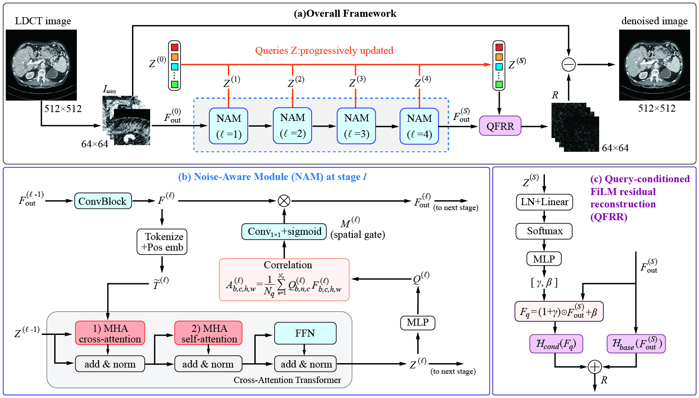

# Mask2Noise: Query-driven explicit perception framework for balancing fidelity and efficiency in low-dose CT denoising

[Paper](https://doi.org/10.1016/j.bspc.2026.111755)

Mask2Noise is a lightweight framework for low-dose CT image denoising that uses learnable degradation queries to guide spatial feature modulation and noise residual reconstruction.

<p align="center">
  
</p>

## Requirements

PyTorch, NumPy, Matplotlib, pandas, pydicom, and openpyxl. Install a PyTorch build compatible with your CUDA environment.

## Dataset

[2016 NIH-AAPM Low-Dose CT Grand Challenge](https://www.aapm.org/GrandChallenge/LowDoseCT/). 

Piglet data must be obtained from its original provider.  

## Citation

```bibtex
@article{ji2026mask2noise,
  title   = {{Mask2Noise}: Query-driven explicit perception framework for balancing fidelity and efficiency in low-dose CT denoising},
  author  = {Jianbing Ji, Zhengyu Chen, Zhaoqiang Yu, Yan Huang, Wenxuan Huang,  Liqin Huang and Shu Chen},
  keywords = {Image denoising, Low-dose CT, Fidelity–efficiency trade-off, Degradation representation, Query-conditioned modeling},
  journal = {Biomedical Signal Processing and Control},
  year    = {2026},
  doi     = {10.1016/j.bspc.2026.111755}
}
```

## Acknowledgements

We thank the authors of [CTformer](https://github.com/wdayang/CTformer) and [DenoMamba](https://github.com/icon-lab/denomamba) for making their implementations publicly available.
